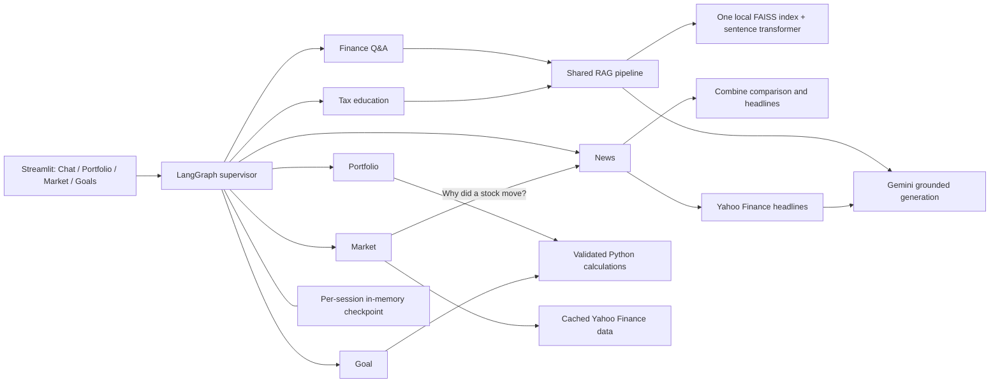

# Finnie — AI Finance Assistant

Applied Agentic AI capstone: financial education through six specialized agents, LangGraph orchestration, local retrieval, deterministic calculators, and a Streamlit interface. Local deployment is supported; no cloud deployment is required.

## Run locally

Python 3.11–3.13 recommended. From this project directory:

```bash
python3 -m venv .venv
source .venv/bin/activate
python -m pip install -r requirements.txt
cp .env.example .env
# Edit .env and set GOOGLE_API_KEY. Never commit credentials.
python -m streamlit run src/web_app/app.py
```

Open the localhost URL printed by Streamlit. An existing `.env` should be kept rather than overwritten. `GEMINI_MODEL` must name a model available to your Google account. The default preserves the original project's model selection. Portfolio and goal calculators work without a model connection. Chat uses Gemini; if unavailable, routing falls back to rules, numerical agents still work, and source-dependent agents explain their unavailability.

The existing FAISS index uses `sentence-transformers/all-MiniLM-L6-v2`. Its first use downloads model weights if not already cached. The environment requires `langchain-huggingface` and `sentence-transformers`, included in requirements. Only load the trusted local index bundled with this project: FAISS's metadata file uses pickle; do not replace it with an untrusted index.

To rebuild after editing the knowledge base:

```bash
python -m src.rag.ingest
```

For a terminal conversation:

```bash
python main.py
```

## Use the application

- **Chat** opens with starter questions. Try “What is an ETF?” followed by “How does it differ from a mutual fund?” The reply names the specialist and groups citations in an expandable **Sources** panel. The sidebar lets you select a specialist for the next question, after which routing returns to **Automatic**. **Advanced search settings** includes an optional knowledge category filter for Finance Q&A and Tax.
- **Voice questions** use the microphone in the Chat bar. Allow microphone access, speak your question, and click the square to stop. Finnie sends your recording to OpenAI for transcription and fills the chat bar with editable text. Click the send arrow when you're ready. Set `OPENAI_API_KEY` in your local `.env` or as a top-level secret in Streamlit Cloud to enable the microphone.
- **Portfolio** lets you load the illustrative sample or enter holdings and select **Analyze holdings**. Finnie requests the latest available USD prices from Yahoo Finance for stocks, ETFs, and mutual funds, and shows their timestamps. Enter cash as a USD amount in Quantity and enter manual USD prices for bonds and other holdings. Finnie combines duplicate tickers and shows allocation, concentration, and expense ratios. Missing fund expense ratios remain unknown.
- **Market** starts with a selectable watchlist. Click a row or search by company name or ticker to open its chart and automatically load recent news. Company search handles common typos when it finds a close match. Switch periods on the chart or use **Back to market overview** to return to the watchlist. Quotes show their price and retrieval timestamps and may be delayed. The selected ticker supplies context for Market and News questions in Chat.
- **Goals** projects a savings balance using your target, timeline, current savings, monthly contribution, and assumed return. The chart marks the target. The results show the required monthly contribution and either the projected shortfall or surplus. If you contribute more than required, Finnie shows the extra amount per month. Risk appetite is recorded as context. The assumed annual return drives the growth calculation.

You can also enter a goal directly in Chat. Try **“My savings goal is $1,200 in one year. I have $0 saved, contribute $80 per month, and assume a 0% annual return.”** The expected result is a **$960** projected balance and a **$240** shortfall. Reaching the target would take **$100 per month**, or **$20 more** than the current contribution. Chat inputs apply to the current calculation, and any saved goal supplies assumptions you leave out.

## Tools and technologies

Voice uses OpenAI's `whisper-1` by default. OpenAI lists February 26, 2027 as its shutdown date. Set `OPENAI_TRANSCRIPTION_MODEL=gpt-transcribe` to use the newer file transcription model. [OpenAI transcription guide](https://developers.openai.com/api/docs/guides/transcription)

| Tool | What Finnie uses it for |
| --- | --- |
| FAISS and the local `all-MiniLM-L6-v2` embedding model | Finance Q&A and Tax Education retrieve passages and cite sources through a shared RAG pipeline. Finance Q&A searches broadly, while Tax Education gives IRS sources priority and distinguishes jurisdiction and tax year. |
| Yahoo Finance via `yfinance` | Market Analysis resolves company names to tickers and retrieves quotes and historical prices. News Synthesis retrieves headlines and article links. |
| Python calculators | Portfolio Analysis calculates allocation and concentration. Goal Planning projects savings and estimates the monthly contribution needed to reach a target. |
| Gemini | Interprets questions, helps route them to a specialist, and generates explanations from retrieved evidence or calculated results. |
| LangGraph | Runs the router and six specialists and maintains conversation state. |
| Streamlit and Plotly | Provide the chat interface, dashboards, and interactive charts. |

Ask **“Show me Costco stock today”** in Chat to see the market flow. LangGraph routes the question to Market Analysis, which resolves Costco to `COST` and requests intraday data from Yahoo Finance. Finnie displays the latest available price alongside its timestamp. You can also enter **Costco** or **COST** directly in the Market tab.

Ask **“Why did NVIDIA move differently from the broader market today?”** to see **Market → News** in action. Market resolves the ticker and compares its return with SPY. News receives the measured comparison and looks for relevant company reporting. If the headlines don’t establish a cause for the difference, the response says so.

## Architecture



The supervisor selects the first specialist for each turn. For a market “why” question, Market passes its resolved ticker and comparison to News. A separate graph step combines both results, and Chat shows both specialists. Agents also share holdings, goal inputs, ticker, and bounded conversation history across turns. Each browser session owns its compiled graph and random thread ID. History keeps the last ten exchanges; restart or clear conversation to discard memory. There is no account authentication or disk persistence.

See [technical design](docs/technical_design.md) for interfaces and tradeoffs, [requirements mapping](docs/capstone_checklist.md) for submission scope, and [demo script](docs/demo_script.md) for a suggested recording.

## Use Finnie from an MCP client

The local MCP server exposes three tools. The client starts Finnie as a subprocess and exchanges MCP messages over standard input and output. The tools call the same calculations and market service used by the app.

| MCP tool | Example task |
| --- | --- |
| `finnie_analyze_portfolio` | Calculate allocation and concentration using supplied holdings and prices. |
| `finnie_project_goal` | Project savings and calculate the monthly contribution needed to reach a target. |
| `finnie_market_quote` | Resolve Costco or COST and return a Yahoo Finance quote with timestamps. |

Install the dependencies from `requirements.txt`. For a desktop MCP client that accepts an `mcpServers` configuration, add Finnie using absolute paths to your checkout:

```json
{
  "mcpServers": {
    "finnie": {
      "command": "/absolute/path/to/Finnie/.venv/bin/python",
      "args": ["/absolute/path/to/Finnie/mcp_server.py"]
    }
  }
}
```

Restart the client, then try “Use Finnie to project saving $100 per month for one year at 0% annual return toward a $1,200 target.” The calculator runs locally. Market quotes require network access to Yahoo Finance. These tools work without a Gemini API key.

Run `python -m pytest -q tests/test_mcp_server.py` from the project folder to see a Python MCP client launch the server, discover its tools, and verify calculator results and input errors. See the [official MCP Python SDK](https://github.com/modelcontextprotocol/python-sdk/tree/v1.x) for the client and server APIs.

## Tests

```bash
python -m pytest -q
python -m pytest --cov=src.agents --cov=src.workflow --cov=src.core --cov=src.utils.calculators --cov=src.rag.pipeline --cov=src.rag.retriever --cov-report=term-missing
```

The suite uses mocked providers for repeatable offline tests and Streamlit AppTest for UI interactions. Coverage command scope is the runtime backend; data curation scripts, index-building utilities, and the UI are not included in that percentage. UI behavior is tested separately. Tests do not prove financial correctness of model-generated prose or live provider availability.

## Troubleshooting

| Symptom | Action |
| --- | --- |
| Model unavailable | Check `GOOGLE_API_KEY`, account quota, and `GEMINI_MODEL`; restart the app after editing `.env`. |
| Missing embedding dependency | Install the complete `requirements.txt` in the active virtual environment. |
| Embedding download failure | Allow access to Hugging Face for the initial download, or use a previously cached model. |
| Missing FAISS index | Run `python -m src.rag.ingest`; do not use an index from an untrusted source. |
| No market data | Check ticker, connectivity, and provider limits. Wait and retry. Stale cached prices are explicitly marked. |
| Unknown expense ratio | Supply `expense_ratio_pct` for every fund; no fund fee is inferred. |
| Follow-up lacks context | Confirm the same browser session is active; use the specialist selector and saved dashboard inputs to clarify intent. |
| Narrow filter yields no sources | Remove the category filter or use an exact category from `src/data/article_sources.json`. |

The RAG pipeline keeps passages at or below the configured FAISS distance cutoff, `0.90` by default. Lower distances indicate closer matches. If no passage qualifies, Finnie asks you to rephrase and skips generating an answer from weak evidence. The cutoff is set in `config.yaml`.

## Limitations

Finnie provides educational information, not personalized investment, legal, or tax advice. Market history is adjusted and may be delayed. Projections assume a constant effective annual return and end-of-month contributions; they exclude taxes, fees, inflation, and volatility. Holding-level concentration does not measure underlying ETF exposure or a statistically validated risk score. The article manifest contains candidate, excluded, and unreviewed sources; only eligible candidates and local educational summaries are indexed. Candidate status is not expert financial verification. Current tax thresholds are not guaranteed by a static knowledge base.

## Deploy to Streamlit Community Cloud

Push the project to a private GitHub repository and connect it to Streamlit Community Cloud. Create an app from that repository, select the `main` branch, and use `src/web_app/app.py` as the entry point. In **Advanced settings**, select Python 3.13 and enter your Gemini credential in the app's Secrets field:

```toml
GOOGLE_API_KEY = "your-key"
```

Keep local credentials in `.env` or `.streamlit/secrets.toml`. The repository includes the FAISS index, and the first retrieval can download embedding weights. After deployment, test a Chat question, a market lookup, and a savings projection using the hosted URL. [Streamlit deployment guide](https://docs.streamlit.io/deploy/streamlit-community-cloud/deploy-your-app/deploy)
